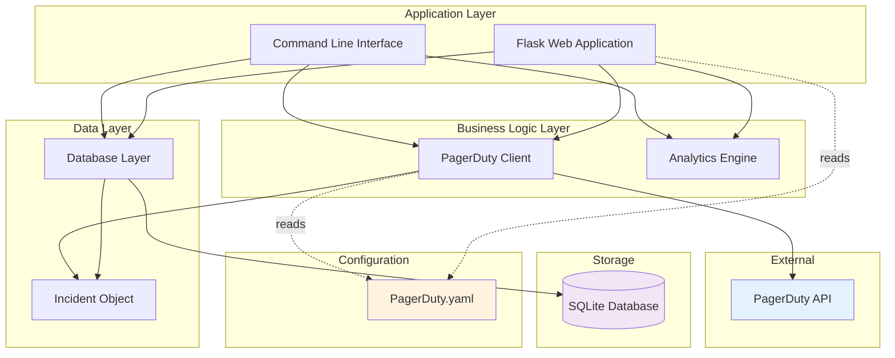
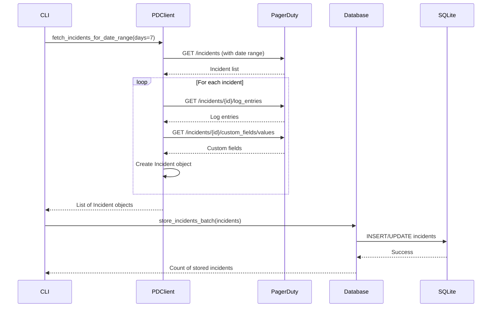
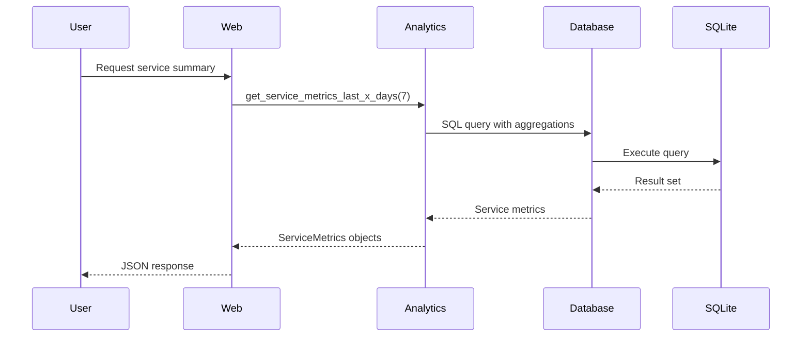
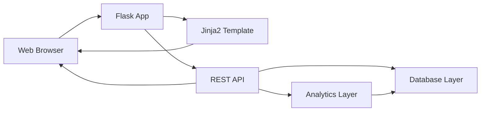

# System Architecture

This document describes the architectural design of the PagerDuty Incident Analytics Dashboard.

## 🏛️ High-Level Architecture



## 📦 Component Overview

### 1. Core Components

| Component | File | Responsibility |
|-----------|------|----------------|
| **Command Interface** | `main_v2.py` | CLI commands and orchestration |
| **Web Application** | `app_v2.py` | Flask routes and REST API |
| **PagerDuty Client** | `pagerduty_client_v2.py` | API integration |
| **Database Layer** | `database_v2.py` | Data persistence |
| **Analytics Engine** | `analytics_v2.py` | Metrics calculation |
| **Incident Model** | `incident_v2.py` | Data transfer object |
| **Config Loader** | `config_loader.py` | Configuration management |

### 2. Supporting Components

| Component | Purpose |
|-----------|---------|
| **Templates** | HTML templates (Bootstrap 5) |
| **Test Suite** | Unit and integration tests |
| **Configuration** | YAML-based service config |

## 🔄 Data Flow Architecture

### Incident Collection Flow



### Analytics Flow



## 🧩 Component Details

### 1. Command Line Interface (main_v2.py)

**Responsibilities:**
- Parse command-line arguments
- Orchestrate component interactions
- Display formatted output
- Handle signals and errors

**Key Functions:**
- `update_incidents_command(days, service_id)` - Data synchronization
- `show_summary_command(days)` - Metrics reporting
- `show_escalations_command(days)` - Escalation analysis
- `database_info_command()` - Database statistics
- `cleanup_command(days)` - Data cleanup

### 2. Web Application (app_v2.py)

**Responsibilities:**
- Serve HTTP requests
- Render HTML templates
- Provide REST API endpoints
- Handle real-time updates

**API Endpoints:**

| Endpoint | Method | Purpose |
|----------|--------|---------|
| `/` | GET | Main dashboard |
| `/admin` | GET | Admin panel |
| `/api/services` | GET | List all services |
| `/api/service/<id>/calendar` | GET | Calendar data |
| `/api/service/<id>/summary` | GET | Service metrics |
| `/api/service/<id>/trends` | GET | Trend data |
| `/api/update` | POST | Trigger data update |
| `/api/stats` | GET | System statistics |

### 3. PagerDuty Client (pagerduty_client_v2.py)

**Responsibilities:**
- Authenticate with PagerDuty API
- Fetch incidents with pagination
- Retrieve log entries for escalation detection
- Extract custom fields
- Handle rate limiting and retries
- Convert API responses to Incident objects

**Key Methods:**
```python
class PagerDutyAPIClient:
    def fetch_incidents_for_date_range(days, service_ids) -> List[Incident]
    def get_incident_log_entries(incident_id) -> List[dict]
    def get_incident_custom_fields(incident_id) -> dict
    def check_if_escalated(log_entries) -> bool
    def load_services_from_config() -> Tuple[List[str], dict]
```

**API Integration Details:**
- **Base URL**: `https://api.pagerduty.com`
- **Authentication**: Token-based (Bearer token)
- **Rate Limiting**: Respects API limits with exponential backoff
- **Pagination**: Automatic pagination handling
- **Timeout Handling**: Configurable timeouts with retry logic

### 4. Database Layer (database_v2.py)

**Responsibilities:**
- Manage SQLite connection
- Execute CRUD operations
- Handle schema migrations
- Ensure data integrity
- Optimize queries with indexes

**Key Methods:**
```python
class IncidentDatabase:
    def store_incident(incident: Incident) -> bool
    def store_incidents_batch(incidents: List[Incident]) -> int
    def get_incident_by_id(incident_id: str) -> Optional[Incident]
    def get_incidents_last_x_days(days: int, service_id: str = None) -> List[Incident]
    def get_escalated_incidents_last_x_days(days: int) -> List[Incident]
    def cleanup_old_incidents(days: int) -> int
```

**Database Schema:**
See [Database Schema](Database-Schema.md) for detailed information.

### 5. Analytics Engine (analytics_v2.py)

**Responsibilities:**
- Calculate incident metrics
- Generate service-level statistics
- Compute trend data
- Provide aggregated reports

**Key Methods:**
```python
class IncidentAnalytics:
    def get_summary_metrics(days: int) -> dict
    def get_service_metrics_last_x_days(days: int) -> List[ServiceMetrics]
    def get_top_escalated_services(days: int, limit: int) -> List[ServiceMetrics]
    def get_daily_trend(days: int, service_id: str = None) -> List[dict]
```

**Metrics Calculated:**
- Total incidents
- Triggered incidents (active)
- Resolved incidents
- Escalated incidents
- Escalation rate (%)
- CCOE resolved incidents
- Infrastructure-caused incidents

### 6. Incident Model (incident_v2.py)

**Responsibilities:**
- Define incident data structure
- Provide helper methods
- Ensure type safety
- Validate data

**Key Properties:**
```python
class Incident:
    id: str
    incident_number: int
    title: str
    status: str
    urgency: str
    priority: Optional[str]
    service_id: str
    service_name: str
    created_at: datetime
    updated_at: datetime
    resolved_at: Optional[datetime]
    html_url: str
    is_escalated: bool
    resolved_by_ccoe: bool
    prelim_root_cause: Optional[str]
```

**Helper Methods:**
```python
def is_triggered_or_acknowledged() -> bool
def is_resolved() -> bool
def is_caused_by_infrastructure() -> bool
```

## 🗄️ Data Storage Architecture

### Database Design Principles

1. **Single Source of Truth**: SQLite database stores all incident data
2. **Idempotent Updates**: Incidents can be updated multiple times safely
3. **Efficient Querying**: Indexes on frequently queried columns
4. **Date Range Optimization**: Optimized for time-based queries
5. **Schema Evolution**: Supports migrations for schema changes

### Data Retention

- **Default Retention**: Unlimited (manual cleanup required)
- **Cleanup Command**: `--cleanup <days>` removes old data
- **Recommended**: Monthly cleanup of data older than 90 days

## 🌐 Web Architecture

### Frontend Stack

- **UI Framework**: Bootstrap 5.3
- **Charts**: Chart.js 4.x
- **Icons**: Bootstrap Icons
- **HTTP Client**: Fetch API

### Backend Stack

- **Web Framework**: Flask 2.3+
- **Template Engine**: Jinja2
- **JSON Serialization**: Built-in JSON module
- **Timezone Handling**: Python datetime with UTC-7

### Request Flow



## 🔒 Security Considerations

### API Token Security

- **Storage**: Plain text in `PagerDuty.yaml` (local development)
- **Production**: Use environment variables or secret management
- **Permissions**: Requires only **Read** permissions
- **Rotation**: Support for token updates without code changes

### Web Security

- **No Authentication**: Local development only
- **Production Recommendation**: Add authentication layer
- **XSS Protection**: Flask default protections enabled
- **CORS**: Not enabled (same-origin only)

## 📈 Scalability Considerations

### Current Limitations

- **SQLite**: Single-writer limitation
- **No Caching**: Every request hits database
- **Synchronous Processing**: Sequential API calls
- **In-Memory Processing**: Large datasets may consume memory

### Scaling Recommendations

For large deployments (100+ services, 10000+ incidents/month):

1. **Database**: Migrate to PostgreSQL or MySQL
2. **Caching**: Add Redis for frequently accessed metrics
3. **Async Processing**: Use Celery for background tasks
4. **API Rate Limiting**: Implement client-side rate limiting
5. **Load Balancing**: Deploy multiple Flask instances

## 🔧 Configuration Architecture

### Configuration Files

| File | Purpose | Format |
|------|---------|--------|
| `PagerDuty.yaml` | API token, service definitions | YAML |
| `requirements.txt` | Python dependencies | Text |
| `launch.json` | VS Code debug config | JSON |

### Environment Variables

Currently not used, but recommended for production:

- `PAGERDUTY_API_TOKEN` - API token
- `DATABASE_PATH` - SQLite database path
- `FLASK_PORT` - Web server port
- `FLASK_DEBUG` - Debug mode toggle

## 🧪 Testing Architecture

See [Testing Guide](Testing.md) for detailed information.

**Test Structure:**
- Unit tests for each component
- Integration tests for API and database
- Fixtures for test data
- Test database isolation

## 📊 Monitoring & Observability

### Current Capabilities

- **Console Logging**: Command output with status messages
- **Error Handling**: Try-catch with stack traces
- **Progress Indicators**: Heartbeat messages during long operations

### Production Recommendations

- **Logging Framework**: Add structured logging (e.g., loguru)
- **Metrics**: Export Prometheus metrics
- **APM**: Application performance monitoring
- **Alerts**: PagerDuty integration for system failures (meta!)

## 🔄 Update Strategy

### Incident Data Updates

1. **Full Sync**: Update all services for specified days
2. **Incremental Sync**: Update specific service
3. **Smart Updates**: Only fetch changed incidents (future enhancement)

### Schema Updates

- **Automatic Migration**: Database schema auto-updates on startup
- **Backward Compatible**: New columns with defaults
- **Manual Migration**: For complex changes

---

**See Also:**
- [Database Schema](Database-Schema.md)
- [API Integration](API-Integration.md)
- [Data Flow](Data-Flow.md)
