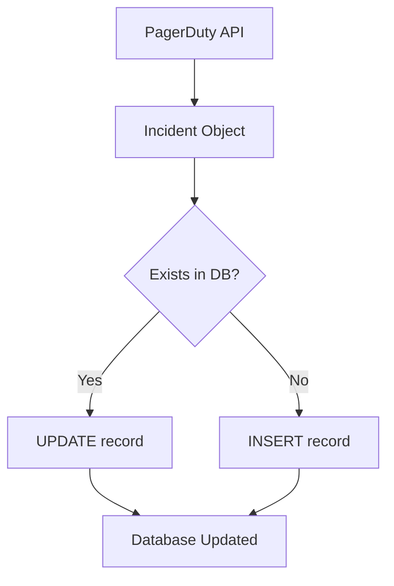

# Database Schema

Complete database schema documentation for the PagerDuty Incident Analytics Dashboard.

## 📊 Schema Overview

The application uses SQLite as its database engine with a single table optimized for incident tracking and analytics.

## 🗄️ Tables

### incidents

The primary table storing all incident data.

```sql
CREATE TABLE IF NOT EXISTS incidents (
    -- Primary identifiers
    id TEXT PRIMARY KEY,
    incident_number INTEGER,
    
    -- Incident details
    title TEXT,
    status TEXT,
    urgency TEXT,
    priority TEXT,
    
    -- Service information
    service_id TEXT,
    service_name TEXT,
    
    -- Timestamps (UTC-7)
    created_at TEXT,
    updated_at TEXT,
    resolved_at TEXT,
    
    -- External reference
    html_url TEXT,
    
    -- Analytics flags
    is_escalated INTEGER DEFAULT 0,
    resolved_by_ccoe INTEGER DEFAULT 0,
    prelim_root_cause TEXT,
    
    -- Metadata
    last_fetched_at TEXT
)
```

## 📋 Column Definitions

### Primary Identifiers

| Column | Type | Constraints | Description |
|--------|------|-------------|-------------|
| `id` | TEXT | PRIMARY KEY | Unique incident ID from PagerDuty (e.g., 'Q1ABC123DEF') |
| `incident_number` | INTEGER | | Sequential incident number |

### Incident Details

| Column | Type | Description |
|--------|------|-------------|
| `title` | TEXT | Incident summary/title |
| `status` | TEXT | Current status: 'triggered', 'acknowledged', 'resolved' |
| `urgency` | TEXT | Urgency level: 'high', 'low' |
| `priority` | TEXT | Priority label (nullable, e.g., 'P1', 'P2') |

### Service Information

| Column | Type | Description |
|--------|------|-------------|
| `service_id` | TEXT | PagerDuty service ID (e.g., 'PHMCGNE') |
| `service_name` | TEXT | Human-readable service name |

### Timestamps

All timestamps are stored as ISO 8601 strings in UTC-7 timezone.

| Column | Type | Description |
|--------|------|-------------|
| `created_at` | TEXT | When incident was created |
| `updated_at` | TEXT | When incident was last updated |
| `resolved_at` | TEXT | When incident was resolved (null if not resolved) |

**Format Example:** `2025-10-20 14:30:45.123456`

### External References

| Column | Type | Description |
|--------|------|-------------|
| `html_url` | TEXT | Direct link to incident in PagerDuty web UI |

### Analytics Flags

| Column | Type | Default | Description |
|--------|------|---------|-------------|
| `is_escalated` | INTEGER | 0 | 1 if incident has escalation log entries, 0 otherwise |
| `resolved_by_ccoe` | INTEGER | 0 | 1 if resolved by CCOE team (custom field: resolution='ccoe') |
| `prelim_root_cause` | TEXT | NULL | Infrastructure component causing incident (e.g., 'rheos', 'hadoop', 'tess') |

### Metadata

| Column | Type | Description |
|--------|------|-------------|
| `last_fetched_at` | TEXT | Timestamp when incident data was last fetched from PagerDuty |

## 🔍 Indexes

Indexes are created for frequently queried columns to optimize performance.

```sql
-- Index for date-range queries
CREATE INDEX IF NOT EXISTS idx_created_at ON incidents(created_at);

-- Index for service-specific queries
CREATE INDEX IF NOT EXISTS idx_service_id ON incidents(service_id);

-- Index for escalation queries
CREATE INDEX IF NOT EXISTS idx_is_escalated ON incidents(is_escalated);

-- Index for status queries
CREATE INDEX IF NOT EXISTS idx_status ON incidents(status);

-- Composite index for service + date queries
CREATE INDEX IF NOT EXISTS idx_service_date ON incidents(service_id, created_at);
```

## 📊 Data Types & Constraints

### Boolean Values

SQLite doesn't have a native boolean type. The application uses INTEGER:
- `0` = False
- `1` = True

**Columns using boolean convention:**
- `is_escalated`
- `resolved_by_ccoe`

### Date/Time Handling

**Storage Format:** ISO 8601 strings
**Timezone:** UTC-7 (Pacific Time without DST consideration)
**Example:** `2025-10-20 14:30:45.123456`

**Date Queries:**
```sql
-- Date range query
SELECT * FROM incidents 
WHERE DATE(created_at) BETWEEN '2025-10-14' AND '2025-10-20';

-- Last 7 days
SELECT * FROM incidents 
WHERE DATE(created_at) >= DATE('now', '-7 days');
```

### NULL Handling

**Nullable Columns:**
- `priority` - Not all incidents have priority
- `resolved_at` - NULL for triggered/acknowledged incidents
- `prelim_root_cause` - NULL if not infrastructure-related

**Non-Nullable Columns:**
- All primary identifiers and core fields
- Analytics flags (have defaults)

## 🔄 Data Lifecycle

### Insert/Update Logic

The application uses "upsert" logic (INSERT OR REPLACE):

```python
INSERT OR REPLACE INTO incidents (
    id, incident_number, title, ...
) VALUES (?, ?, ?, ...)
```

**Behavior:**
- If incident ID exists: Updates all fields
- If incident ID is new: Inserts new record
- Always safe to run multiple times (idempotent)

### Example Data Flow



## 📈 Common Queries

### Get All Incidents for Last 7 Days

```sql
SELECT * FROM incidents
WHERE DATE(created_at) >= DATE('now', '-7 days')
ORDER BY created_at DESC;
```

### Get Escalated Incidents by Service

```sql
SELECT service_name, COUNT(*) as escalation_count
FROM incidents
WHERE is_escalated = 1
  AND DATE(created_at) >= DATE('now', '-30 days')
GROUP BY service_id, service_name
ORDER BY escalation_count DESC;
```

### Calculate Escalation Rate

```sql
SELECT 
    service_name,
    COUNT(*) as total,
    SUM(is_escalated) as escalated,
    ROUND(100.0 * SUM(is_escalated) / COUNT(*), 2) as escalation_rate
FROM incidents
WHERE DATE(created_at) >= DATE('now', '-7 days')
GROUP BY service_id, service_name;
```

### Get CCOE Resolved Incidents

```sql
SELECT * FROM incidents
WHERE resolved_by_ccoe = 1
  AND DATE(created_at) >= DATE('now', '-30 days')
ORDER BY created_at DESC;
```

### Get Infrastructure-Caused Incidents

```sql
SELECT 
    prelim_root_cause,
    COUNT(*) as incident_count
FROM incidents
WHERE prelim_root_cause IS NOT NULL
  AND DATE(created_at) >= DATE('now', '-30 days')
GROUP BY prelim_root_cause
ORDER BY incident_count DESC;
```

### Daily Incident Counts

```sql
SELECT 
    DATE(created_at) as date,
    COUNT(*) as total_incidents,
    SUM(CASE WHEN status IN ('triggered', 'acknowledged') THEN 1 ELSE 0 END) as triggered,
    SUM(CASE WHEN status = 'resolved' THEN 1 ELSE 0 END) as resolved,
    SUM(is_escalated) as escalated
FROM incidents
WHERE DATE(created_at) >= DATE('now', '-30 days')
GROUP BY DATE(created_at)
ORDER BY date DESC;
```

## 🔧 Maintenance Queries

### Database Statistics

```sql
-- Total incident count
SELECT COUNT(*) FROM incidents;

-- Incidents by status
SELECT status, COUNT(*) FROM incidents GROUP BY status;

-- Date range of data
SELECT 
    MIN(DATE(created_at)) as earliest,
    MAX(DATE(created_at)) as latest
FROM incidents;

-- Database size (approx rows)
SELECT COUNT(*) as total_rows FROM incidents;
```

### Cleanup Old Data

```sql
-- Delete incidents older than 90 days
DELETE FROM incidents
WHERE DATE(created_at) < DATE('now', '-90 days');

-- Vacuum to reclaim space
VACUUM;
```

### Find Duplicates (Should not exist)

```sql
SELECT id, COUNT(*) 
FROM incidents 
GROUP BY id 
HAVING COUNT(*) > 1;
```

## 📊 Sample Data

### Example Record

```sql
INSERT INTO incidents VALUES (
    'Q1ABCDEF',                              -- id
    12345,                                   -- incident_number
    'High CPU usage on production server',  -- title
    'resolved',                              -- status
    'high',                                  -- urgency
    'P1',                                    -- priority
    'PHMCGNE',                              -- service_id
    'Sojourner SLA Service',                -- service_name
    '2025-10-20 14:30:45',                  -- created_at
    '2025-10-20 15:45:30',                  -- updated_at
    '2025-10-20 16:00:00',                  -- resolved_at
    'https://ebay-cpt.pagerduty.com/incidents/Q1ABCDEF',  -- html_url
    1,                                       -- is_escalated
    0,                                       -- resolved_by_ccoe
    'rheos',                                 -- prelim_root_cause
    '2025-10-20 17:00:00'                   -- last_fetched_at
);
```

## 🔄 Schema Migrations

### Version History

#### Version 1.0 (Initial)
- Basic incident tracking
- Escalation detection

#### Version 2.0 (Current)
- Added `resolved_by_ccoe` column
- Added `prelim_root_cause` column
- Added `last_fetched_at` column
- Enhanced indexes for performance

### Future Enhancements

Potential schema additions:

```sql
-- Assignment tracking
ALTER TABLE incidents ADD COLUMN assigned_to TEXT;
ALTER TABLE incidents ADD COLUMN assignment_count INTEGER DEFAULT 0;

-- Response time metrics
ALTER TABLE incidents ADD COLUMN first_acknowledged_at TEXT;
ALTER TABLE incidents ADD COLUMN time_to_acknowledge_seconds INTEGER;
ALTER TABLE incidents ADD COLUMN time_to_resolve_seconds INTEGER;

-- Impact tracking
ALTER TABLE incidents ADD COLUMN impacted_services TEXT;  -- JSON array
ALTER TABLE incidents ADD COLUMN customer_impact_level TEXT;
```

## 🛡️ Data Integrity

### Primary Key Constraint

- **Column:** `id`
- **Ensures:** No duplicate incidents
- **Behavior:** INSERT OR REPLACE updates existing records

### Data Validation

Validation is performed at the application layer:

```python
class Incident:
    def validate(self):
        assert self.id, "Incident ID required"
        assert self.status in ['triggered', 'acknowledged', 'resolved']
        assert self.urgency in ['high', 'low']
        assert self.created_at, "Created timestamp required"
```

### Referential Integrity

**No Foreign Keys** - SQLite foreign keys not used in this schema
- Service IDs are validated against `PagerDuty.yaml`
- No cascading deletes needed

## 📏 Performance Characteristics

### Typical Row Size

Approximately **500-800 bytes** per incident

### Query Performance

With indexes:
- **Point lookups** (by ID): < 1ms
- **Date range queries** (7 days): < 10ms
- **Service aggregations**: < 50ms
- **Full table scans**: Depends on row count

### Recommended Limits

- **Max rows**: 100,000 incidents (~ 80MB)
- **Optimal rows**: < 50,000 incidents (~ 40MB)
- **Cleanup frequency**: Monthly (keep 90 days)

## 🔍 Troubleshooting

### Database Locked Error

**Cause:** Multiple writers or long-running transactions

**Solution:**
```python
# Enable WAL mode for better concurrency
connection.execute('PRAGMA journal_mode=WAL')
```

### Slow Queries

**Diagnosis:**
```sql
EXPLAIN QUERY PLAN
SELECT * FROM incidents WHERE created_at >= '2025-10-01';
```

**Solution:** Ensure indexes are created (run schema initialization)

### Corrupted Database

**Check integrity:**
```sql
PRAGMA integrity_check;
```

**Rebuild:**
```bash
sqlite3 pagerduty.db "VACUUM;"
```

---

**See Also:**
- [System Architecture](Architecture.md)
- [Performance Tuning](Performance.md)
- [Backup & Recovery](Backup-Recovery.md)
